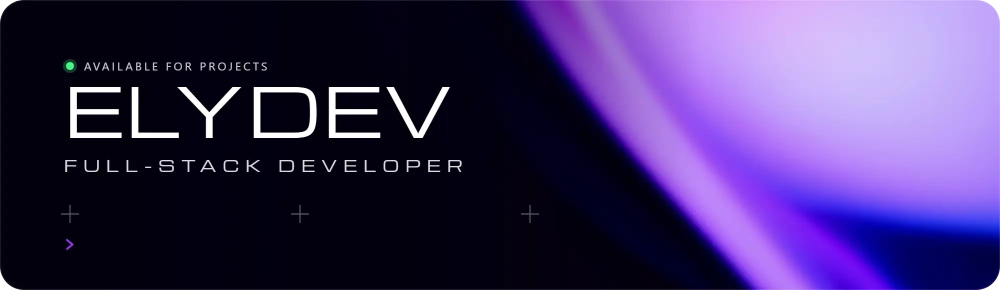

<picture>
  <source media="(prefers-reduced-motion: reduce)" srcset="./assets/header.svg" />
  
</picture>

 

 

---

## About

Senior full-stack developer. I take products from an empty repository to production — interface, API, database, payments and deploy — and when the product has hardware in it, the firmware too.

- **Web platforms.** SaaS products, dashboards and marketing sites in **TypeScript**, **React**, **Next.js** and **Astro**, styled with **Tailwind**, deployed on **Vercel**.
- **Backend and data.** REST APIs in **Node.js** and **Python**, schemas on **PostgreSQL** / **Supabase**, **Stripe** billing, and document and invoicing pipelines (Brazilian NFS-e) automated end to end.
- **Embedded.** Firmware in **C / C++** for **ESP32** and **ESP32-C3** — touch UI, Wi-Fi provisioning, REST API, OTA — with the web panel and Android app that drive it.
- **Graphics and 3D.** **Three.js** in the browser, **Godot** for games, GPU video pipelines for motion graphics.

Currently taking **freelance and project work**, remote. Fixed scope or ongoing.

---

## Tech stack

---

## By the numbers

> **Why these cards are custom.** 93% of these repositories are private client work, so the usual stat widgets — which only read public repos — report close to zero for this account. These are generated from the authenticated GitHub API by [`scripts/update-stats.mjs`](scripts/update-stats.mjs) and refreshed daily by [a GitHub Actions workflow](.github/workflows/update-stats.yml). The commit count is measured per repository, not estimated.

---

## Selected work

Most of these are private repositories — client work and products in flight. I walk through architecture and code on request.

### Products

| project | stack | what it is |
|---|---|---|
| **PostsUp** `private` | Next.js 16 · Supabase · Vercel Workflow · Meta Graph API · Remotion | AI agent that creates social content through chat — carousels, posts and video from scratch — with a canvas/reels editor and scheduled publishing to Instagram, Facebook and Threads. |
| **Flowebooks** `private` | Next.js · TypeScript · Supabase · Stripe | SaaS that turns a one-sentence idea into a finished, formatted ebook — editor, generation pipeline, checkout and delivery. Built entirely by agents through **harness-flowera**. |
| **Flowera Study** `private` | React 19 · PDFium (WASM) · Web Workers · IndexedDB/OPFS · Neon | PDF reader where what you highlight becomes knowledge: highlights turn into blocks linked back to the exact spot in the PDF, then into flashcards scheduled by spaced repetition (FSRS). Rendering, selection and search run on PDFium in a worker. |
| **Flowera 3D** + **Flowera LAB** `private` | Next.js 16 · Three.js · manifold-3d (WASM) · Neon · MCP | Parametric 3D models customised in the browser: the mesh rebuilds in under 250 ms per slider move and exports as manifold-validated STL/3MF. Flowera LAB drives a Bambu Lab A1 printer from an agent over MCP (41 tools) — from slider to printed part. |

### Education platforms

| project | stack | what it is |
|---|---|---|
| **Golden Jus** `private` | React 19 · Supabase (triggers + RPC) · Astro · Python | Legal-exam prep suite. Its study platform, **Código Golden**, schedules every review on a D0→D45 spaced-repetition cycle and re-plans itself when the student falls behind — question lists, flashcards, error notebook, gamification, mentor–student scheduling, an AI mentor over MCP, Hubla payments and D4Sign contracts. Plus the marketing site and automated NFS-e invoicing. |
| **Golden Materiais** + question bank `private` | Python · ReportLab · Node.js · PostgreSQL | The production system behind every Golden PDF: editable source per chapter, official sources (statutes, court bulletins, past exams) checked citation by citation, the layout engine and production state. Plus the migration of the full question bank into normalised Postgres tables, and an archive of **114 past exams with 12,872 questions** extracted and structured. |
| **Pro Residência** `private` | React · TypeScript · Supabase (36 tables, RLS) · TanStack Query | Mentorship platform for medical residency exams: personalised schedules, spaced-repetition reviews, question bank, flashcards, full past exams and an analytics dashboard. |
| **flowera-doc-builder** `private` | Python · ReportLab | PDF engine for printed teaching material with *verifiable* fidelity: six measured document families and a token-by-token comparator. |

### AI, agents and developer tools

| project | stack | what it is |
|---|---|---|
| **harness-flowera** `private` | Node.js · Claude Code · hooks | Harness that lets a team of coding agents ship a full application with no human-written code and no human in the loop: five roles, a verification gate inside the loop, enforcement by hooks. Proven by building Flowebooks end to end. |
| **Flowera UI** `private` | React · Astro · Tailwind · shadcn registry · Turborepo | Component library distributed as a shadcn-compatible registry — 600 component variants, 77 animated components and ready-made blocks for React and Astro. `npx shadcn add @flowera/<item>` copies the source into your project: no package, no lock-in. |
| **flowera-blog** `private` | Astro SSR · PostgreSQL · Better Auth · Node 24 | Multi-tenant blog builder with a theme editor, plus a six-stage article pipeline — topic, writing, SEO/GEO, citation check against an official statute corpus — that fails CI when a citation can't be verified. |
| **Flowera OCR** `private` | Python · Chrome Screen AI | Local OCR built on the engine shipped inside Chrome — library, CLI and HTTP API, producing searchable PDFs. No cloud, no per-page cost. |

### Hardware

| project | stack | what it is |
|---|---|---|
| **CLAUDE-CYD-AI-CHAT** `private` | C · ESP32 · TFT/LVGL · OAuth | AI chat running on a low-cost ESP32 touch display: OAuth sign-in, pt-BR interface, hardware tools, HTTP API. |
| **Desk Companion** `private` | C++ · ESP32-C3 · REST · Android | Open firmware for an OLED desk companion, with a web panel, REST API and companion Android app. |

### Graphics, games and video

| project | stack | what it is |
|---|---|---|
| **Último de Pé** `private` | Three.js · matter.js · Node.js · Python · Supabase · Meta Graph API | Fully automated content system for a 3D demolition series on Instagram — no human between the idea and the post. Bots pick each battle, simulate the cars in a 3D physics arena, render the match headless on a GPU queue, add a generated announcer, captions and HUD, and publish it. Once it is live, more bots answer comments and DMs and run the tournaments on Supabase. |
| **Guitar Clash** `private` | React · Three.js (R3F) · Supabase · PeerJS | Rhythm game in the browser: 3D highway, five-fret engine with HOPOs, taps, sustains and star power, a community chart catalogue, cloud progression, ranking and P2P multiplayer. |
| **guitar3d-engine** `private` | Three.js · alphaTab · mediabunny | Web engine that renders Guitar Pro tablature as 3D guitar playthrough videos, exported as MP4 straight from the browser. |
| **flowera-motion-graphics** `private` | JavaScript · GPU pipeline · FFmpeg | Motion-graphics and creative pipeline — video, audio and automated QA, driven entirely from code. |

---

## What I bring to a team

**The whole thing ships.** Interface, API, schema, payments, deploy and the monitoring afterwards. No gaps between layers, because there is no handoff between people.

**Measured, not assumed.** "Looks right" is not a result. I verify with tests, typed boundaries and comparators that show the diff — the cards above are generated and refreshed by code, not pasted screenshots.

**Hardware when the product needs it.** Few web developers also flash the device, write its REST API and ship the app that talks to it. When a product spans both, that is one less vendor to coordinate.

---

## Get in touch

<!-- Para publicar seu e-mail, descomente e troque o endereço:

-->

  

**Hiring or scoping a project?** Send the brief — you get scope, timeline and price back.

