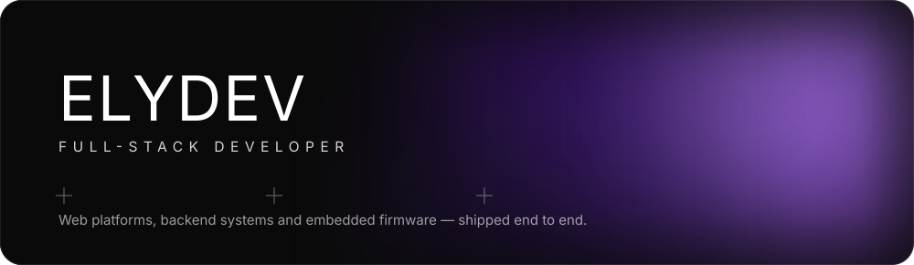
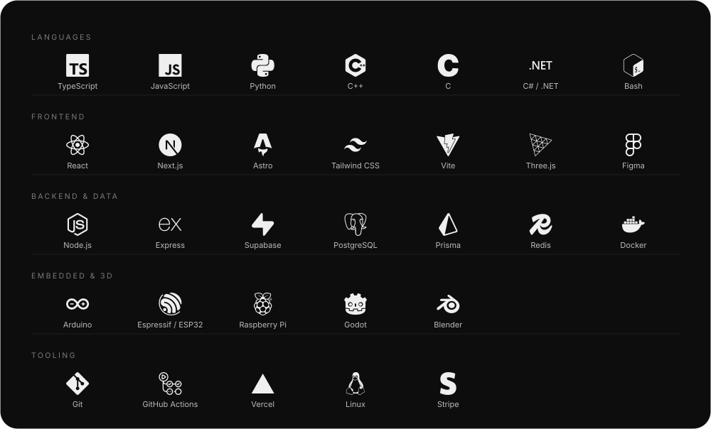
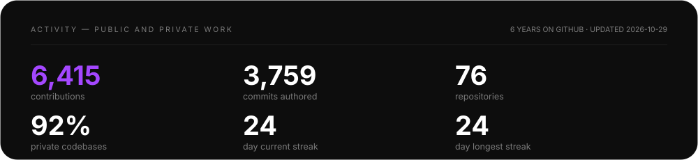
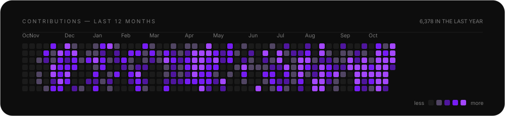
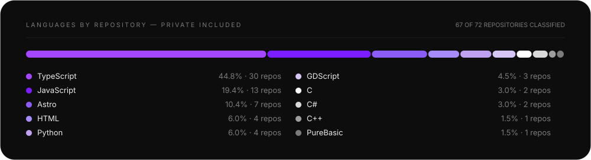

 

 

---

## About

Senior full-stack developer. I take products from an empty repository to production — interface, API, database, payments and deploy — and when the product has hardware in it, the firmware too.

- **Web platforms.** SaaS products, dashboards and marketing sites in **TypeScript**, **React**, **Next.js** and **Astro**, styled with **Tailwind**, deployed on **Vercel**.
- **Backend and data.** REST APIs in **Node.js** and **Python**, schemas on **PostgreSQL** / **Supabase**, **Stripe** billing, and document and invoicing pipelines (Brazilian NFS-e) automated end to end.
- **Embedded.** Firmware in **C / C++** for **ESP32** and **ESP32-C3** — touch UI, Wi-Fi provisioning, REST API, OTA — with the web panel and Android app that drive it.
- **Graphics and 3D.** **Three.js** in the browser, **Godot** for games, GPU video pipelines for motion graphics.

Currently taking **freelance and project work**, remote. Fixed scope or ongoing.

---

## Tech stack

---

## By the numbers

> **Why these cards are custom.** 92% of these repositories are private client work, so the usual stat widgets — which only read public repos — report close to zero for this account. These are generated from the authenticated GitHub API by [`scripts/update-stats.mjs`](scripts/update-stats.mjs) and refreshed daily by [a GitHub Actions workflow](.github/workflows/update-stats.yml). The commit count is measured per repository, not estimated.

---

## Selected work

| project | stack | what it is |
|---|---|---|
| **Flowebooks** `private` | Next.js · TypeScript · Supabase · Stripe | SaaS that turns a one-sentence idea into a finished, formatted ebook — editor, generation pipeline, checkout and delivery. |
| **Flowera 3D** `private` | Next.js · Three.js · TypeScript · Stripe | Parametric 3D model platform: customise a model in the browser, see it rendered instantly, pay and download. |
| **Golden Jus** `private` | Astro · TypeScript · Tailwind · Python | Legal-education product suite — sites, study platform and automated NFS-e invoicing against the Brazilian national issuer. |
| **Aprova.ai** `private` | Next.js 16 · React 19 · shadcn/ui | Study dashboard built pixel-faithful to its Figma design system. |
| [**AutoGest**](https://github.com/ely669/autogest-app) | React Native (Expo) · Express · TypeScript | Management platform for car repair shops — mobile app plus REST backend. |
| **flowera-doc-builder** `private` | Python · ReportLab | PDF engine for printed teaching material with *verifiable* fidelity: six measured document families and a token-by-token comparator. |
| **flowera-motion-graphics** `private` | JavaScript · GPU pipeline · FFmpeg | Motion-graphics and creative pipeline — video, audio and automated QA, driven entirely from code. |
| **CLAUDE-CYD-AI-CHAT** `private` | C · ESP32 · TFT/LVGL · OAuth | AI chat running on a low-cost ESP32 touch display: OAuth sign-in, pt-BR interface, hardware tools, HTTP API. |
| **Desk Companion** `private` · [app](https://github.com/ely669/flow-app) | C++ · ESP32-C3 · REST · Android | Open firmware for an OLED desk companion, with a web panel, REST API and companion Android app. |
| **ocr-chrome** `private` | JavaScript · Chrome Screen AI | Local OCR built on the engine shipped inside Chrome — library, CLI and HTTP API. No cloud, no per-page cost. |
| **guitar3d-engine** `private` | Three.js · alphaTab · mediabunny | Web engine that renders Guitar Pro tablature as 3D guitar playthrough videos. |

Most of these are private repositories — client work and products in flight. I walk through architecture and code on request.

---

## What I bring to a team

**The whole thing ships.** Interface, API, schema, payments, deploy and the monitoring afterwards. No gaps between layers, because there is no handoff between people.

**Measured, not assumed.** "Looks right" is not a result. I verify with tests, typed boundaries and comparators that show the diff — the cards above are generated and refreshed by code, not pasted screenshots.

**Hardware when the product needs it.** Few web developers also flash the device, write its REST API and ship the app that talks to it. When a product spans both, that is one less vendor to coordinate.

---

## Get in touch

<!-- Para publicar seu e-mail, descomente e troque o endereço:

-->

  

**Hiring or scoping a project?** Send the brief — you get scope, timeline and price back.

