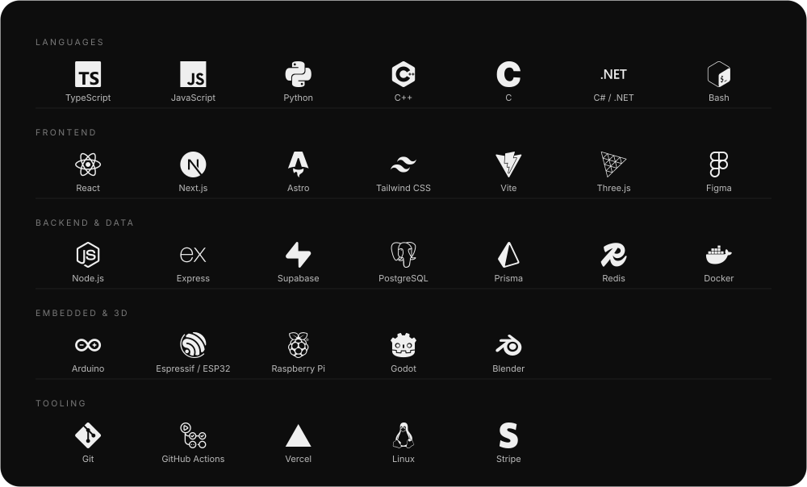
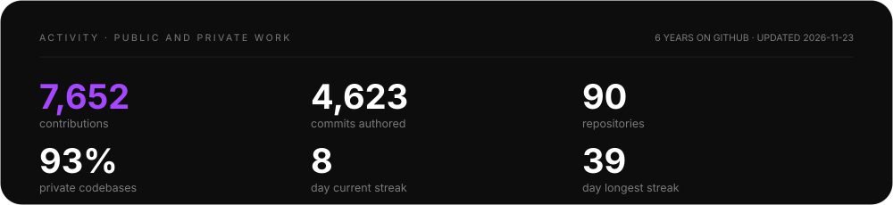
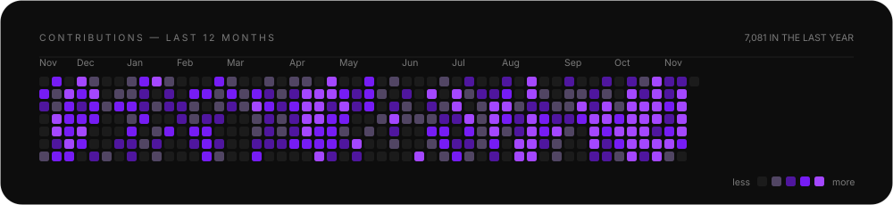
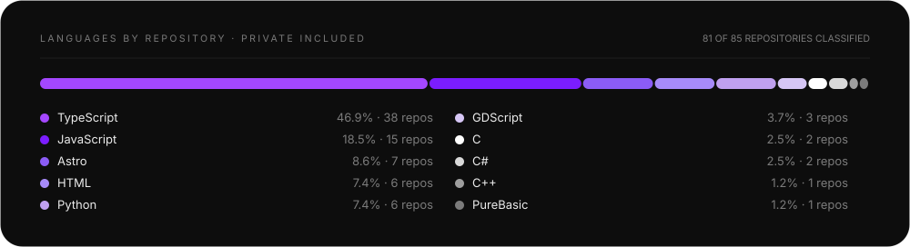

<picture>
  <source media="(prefers-reduced-motion: reduce)" srcset="./assets/header.svg" />
  
</picture>

 

 

---

## About

I'm Ely, a full-stack developer based in Goiás, Brazil. I build web products from the first commit to production: the interface, the API, the database, payments and deploy. When a product involves hardware, I write the firmware too.

Most of my work today is for education companies and for my own products under Flowera. A growing part of it is AI: agents that write code, create content and publish it with nobody in the loop.

What I work with:

- **Web:** TypeScript, React, Next.js and Astro, styled with Tailwind and deployed on Vercel.
- **Backend:** APIs in Node.js and Python, PostgreSQL and Supabase, Stripe billing and automated Brazilian invoicing (NFS-e).
- **Embedded:** C and C++ firmware for ESP32 boards, including touch interfaces, Wi-Fi setup, a REST API and over-the-air updates.
- **Graphics:** Three.js in the browser, Godot for games and video pipelines that render on the GPU.

I'm open to freelance and project work, remote, with a fixed scope or ongoing.

---

## Tech stack

---

## By the numbers

> **About these cards:** 94% of my repositories are private, so the usual stat widgets, which only read public repos, show almost nothing for this account. These cards come from the authenticated GitHub API through [`scripts/update-stats.mjs`](scripts/update-stats.mjs), and [a GitHub Actions workflow](.github/workflows/update-stats.yml) updates them every day. Commits are counted repo by repo.

---

## Selected work

Most of these repositories are private because they belong to clients or to products still in development. I'm happy to walk through the architecture and the code on a call.

### Products

<table>
  <tr><th width="17%">project</th><th width="26%">stack</th><th width="57%">what it is</th></tr>
  <tr><td><b>PostsUp</b> <code>private</code></td><td>Next.js 16 · Supabase · Vercel Workflow · Meta Graph API · Remotion</td><td>An AI agent that creates social media content through chat: carousels, posts and videos made from scratch. It has a canvas and reels editor and schedules posts to Instagram, Facebook and Threads.</td></tr>
  <tr><td><b>Flowebooks</b> <code>private</code></td><td>Next.js · TypeScript · Supabase · Stripe</td><td>Turns a one-sentence idea into a finished, formatted ebook, with the editor, the generation pipeline, checkout and delivery. Every line of code was written by agents running on <b>harness-flowera</b>.</td></tr>
  <tr><td><b>Flowera Study</b> <code>private</code></td><td>React 19 · PDFium (WASM) · Web Workers · IndexedDB/OPFS · Neon</td><td>A PDF reader built for studying. Each highlight becomes a note linked to its exact spot in the PDF and can turn into a flashcard with spaced repetition (FSRS). Rendering, text selection and search run on PDFium inside a web worker.</td></tr>
  <tr><td><b>Flowera 3D</b> + <b>Flowera LAB</b> <code>private</code></td><td>Next.js 16 · Three.js · manifold-3d (WASM) · Neon · MCP</td><td>Customise parametric 3D models in the browser. The mesh updates in under 250 ms as you move a slider and exports as a print-ready STL or 3MF, checked for mesh errors first. Flowera LAB connects an agent to a Bambu Lab A1 printer over MCP (41 tools), so a model can go from the browser to the print bed.</td></tr>
  <tr><td><b>harness-flowera</b> <code>private</code></td><td>Node.js · Claude Code · hooks</td><td>A setup that lets a team of coding agents build a complete application with no human-written code and nobody stepping in during the run. It splits the work into five roles, checks every step before moving on and enforces the rules with hooks. Flowebooks was built with it.</td></tr>
</table>

### Education platforms

<table>
  <tr><th width="17%">project</th><th width="26%">stack</th><th width="57%">what it is</th></tr>
  <tr><td><a href="https://goldenjus.vercel.app"><b>Golden Jus</b></a> <code>private</code></td><td>React 19 · Supabase (triggers + RPC) · Astro · Python</td><td>Prep platform for Brazilian legal exams. Its study app, <b>Código Golden</b>, schedules reviews on a D0 to D45 spaced repetition cycle and rebuilds the plan when a student falls behind. It also has question lists, flashcards, an error notebook, gamification, mentor scheduling, an AI mentor over MCP, payments through Hubla and contracts through D4Sign. I also built the marketing site and the automated NFS-e invoicing.</td></tr>
  <tr><td><a href="https://pro-residencia.vercel.app"><b>Pro Residência</b></a> <code>private</code></td><td>React · TypeScript · Supabase (36 tables, RLS) · TanStack Query</td><td>Mentorship platform for medical residency exams, with personalised schedules, spaced repetition reviews, a question bank, flashcards, full past exams and a dashboard to track progress.</td></tr>
</table>

### AI, agents and developer tools

<table>
  <tr><th width="17%">project</th><th width="26%">stack</th><th width="57%">what it is</th></tr>
  <tr><td><b>Flowera UI</b> <code>private</code></td><td>React · Astro · Tailwind · shadcn registry · Turborepo</td><td>A component library shipped as a shadcn-compatible registry: 600 component variants, 77 animated components and ready-made blocks for React and Astro. Running <code>npx shadcn add @flowera/&lt;item&gt;</code> copies the source straight into your project.</td></tr>
  <tr><td><b>flowera-blog</b> <code>private</code></td><td>Astro SSR · PostgreSQL · Better Auth · Node 24</td><td>Multi-tenant blog builder with a theme editor. Articles go through a six-step pipeline (topic, writing, SEO and GEO, then a check of every citation against the official text of the law), and the build fails if any citation can't be verified.</td></tr>
  <tr><td><b>Flowera OCR</b> <code>private</code></td><td>Python · Chrome Screen AI</td><td>OCR that runs entirely on your machine, using the Screen AI engine that ships with Chrome. It works as a library, a CLI or an HTTP API and produces searchable PDFs, with no cloud service and no per-page cost.</td></tr>
  <tr><td><b>Golden Materiais</b> + question bank <code>private</code></td><td>Python · ReportLab · Node.js · PostgreSQL</td><td>The system behind every PDF Golden publishes. It keeps the editable source of each chapter, the official sources (laws, court bulletins, past exams) used to check every citation, the layout engine and the production status. I also migrated the full question bank into Postgres and built an archive of <b>114 past exams with 12,872 questions</b>, extracted and organised.</td></tr>
  <tr><td><b>flowera-doc-builder</b> <code>private</code></td><td>Python · ReportLab</td><td>PDF engine for printed study material whose output can be checked against the original. It covers six document families measured from real files and compares the result token by token.</td></tr>
</table>

### Hardware

<table>
  <tr><th width="17%">project</th><th width="26%">stack</th><th width="57%">what it is</th></tr>
  <tr><td><b>CLAUDE-CYD-AI-CHAT</b> <code>private</code></td><td>C · ESP32 · TFT/LVGL · OAuth</td><td>AI chat on a cheap ESP32 touchscreen board, with OAuth sign-in, a Portuguese interface, hardware tools and an HTTP API.</td></tr>
  <tr><td><b>Desk Companion</b> <code>private</code></td><td>C++ · ESP32-C3 · REST · Android</td><td>Open firmware for a small OLED desk companion, with its own web panel, REST API and Android app.</td></tr>
</table>

### Graphics, games and video

<table>
  <tr><th width="17%">project</th><th width="26%">stack</th><th width="57%">what it is</th></tr>
  <tr><td><a href="https://www.instagram.com/ultimodepe.br/"><b>Último de Pé</b></a> <code>private</code></td><td>Three.js · matter.js · Node.js · Python · Supabase · Meta Graph API</td><td>A content system that runs a 3D demolition series on Instagram without anyone touching it. Bots choose each battle, simulate the cars in a 3D physics arena, render the match on a GPU queue, add an AI announcer, captions and on-screen graphics, and publish the video. Once it's live, other bots reply to comments and DMs and run the tournaments in Supabase.</td></tr>
  <tr><td><b>Guitar Clash</b> <code>private</code></td><td>React · Three.js (R3F) · Supabase · PeerJS</td><td>A rhythm game that runs in the browser, with a 3D note highway, a five-fret engine with HOPOs, taps, sustains and star power, songs from the community chart catalogue, saved progress, rankings and peer-to-peer multiplayer.</td></tr>
  <tr><td><a href="https://www.instagram.com/3dguitartabs/"><b>guitar3d-engine</b></a> <code>private</code></td><td>Three.js · alphaTab · mediabunny</td><td>Turns a Guitar Pro tab into a video of a 3D guitar playing the song, exported as MP4 right in the browser.</td></tr>
  <tr><td><b>flowera-motion-graphics</b> <code>private</code></td><td>JavaScript · GPU pipeline · FFmpeg</td><td>My motion graphics pipeline for video, audio and automatic quality checks, all driven from code.</td></tr>
</table>

---

## How I work

I take care of the whole product: interface, API, database, payments, deploy and the monitoring after launch. With one person across every layer, nothing gets lost between them.

I check my work with tests, typed code and tools that compare the result against the reference. The cards above are a small example, since code generates and updates them every day.

I can also handle the hardware side. If your product includes a device, I can write its firmware, its API and the app that controls it, so you don't need a separate vendor for that.

---

## Get in touch

<!-- Para publicar seu e-mail, descomente e troque o endereço:

-->

  

**Hiring or planning a project?** Send me what you have in mind and I'll get back to you with scope, timeline and price.

